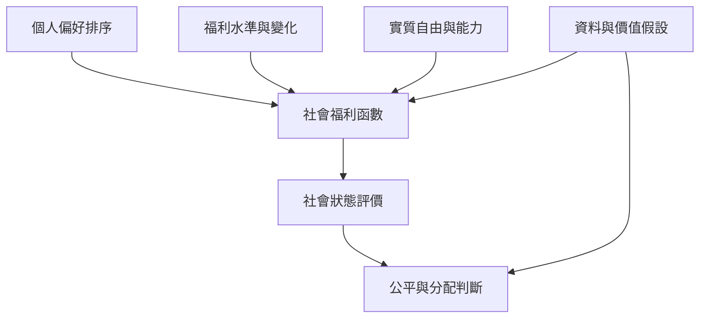

福利聚合不只是把人們的排序加總，而是要決定哪些資訊足以評價社會狀態。Sen 的研究提醒我們，若只採用序位偏好，可能忽略不同人的實質處境；人際福利比較與能力取徑提供更豐富的評價視角，但也需要公開其倫理與量測假設。

[[Sen以福利資訊與正義問題擴展社會選擇研究]]、[[人際福利比較決定社會評價可以使用哪些資訊]]、[[公平不只是每人一票也包含偏好與負擔的可見性]]、[[公共資源分配應同時呈現票數需求強度與弱勢影響]]。
