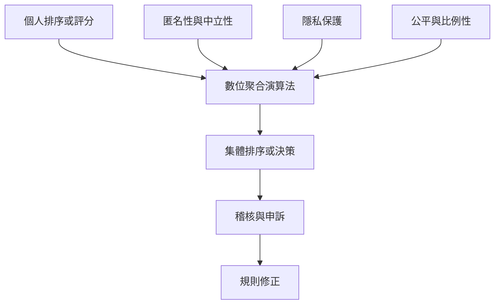

計算社會選擇將傳統投票規則帶入數位平台與大規模演算法設計。當系統處理排序、推薦、投票與資源分配時，匿名性、中立性、隱私、公平、效率與可解釋性可能互相牽制。技術設計因此必須清楚界定價值目標，並接受檢驗與申訴。

[[計算社會選擇把投票機制設計成公平與可計算的演算法]]、[[公平不只是每人一票也包含偏好與負擔的可見性]]、[[把演算法公平測試納入社群數位工具的採購條件]]、[[匿名性]]、[[中立性]]、[[策略無關性]]。
