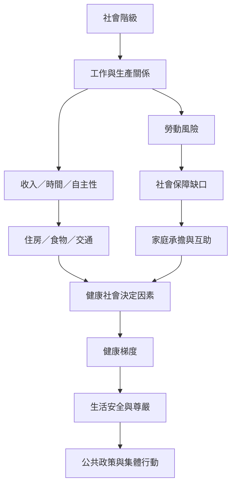

階級透過工作條件、收入與財富、社會保障、居住環境和照顧分工影響身體與日常生活。新型態勞動可能改變風險形式，但不會自動消除不平等。此圖從勞動關係連到生活結果與集體回應。

核心筆記：[[工作形式變新不代表階級關係自然消失]]、[[健康梯度反映社會資源的累積性分配]]、[[互助照顧與公共服務能降低階級風險卻需避免浪漫化]]。

相關概念：[[不穩定階級]]、[[社會保障]]、[[健康社會決定因素]]、[[剝削]]、[[社會階級]]。

[[Social_class]]
