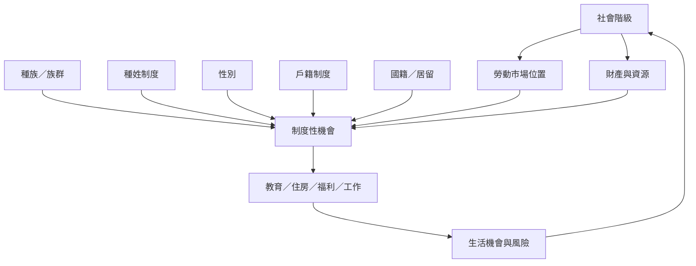

階級在不同地區透過不同歷史制度運作。種族、種姓、性別、戶籍、國籍與福利資格會影響資源取得、社會承認和風險分配。此圖強調交織性並非額外加上一個身分欄位，而是制度關係彼此構成。

閱讀時可對照 [[種族種姓性別與階級相互形塑而非簡單相加]]、[[戶籍與福利制度會把身分差異轉化為階級差異]]，並注意 [[階級分類必須兼顧可比較與在地歷史]]。

相關概念：[[交織性]]、[[種姓制度]]、[[戶籍制度]]、[[社會保障]]、[[社會階級]]。

[[Social_class]]
