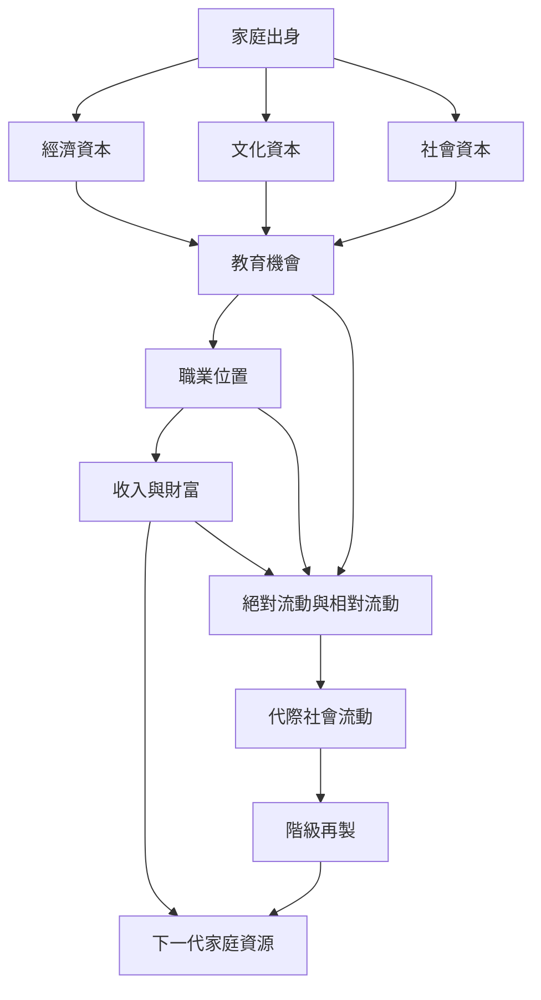

階級位置不會只靠單次收入或個人選擇傳遞，而是經由家庭資源、教育制度、勞動市場、財產累積與制度門檻，在生命歷程和世代之間延續。此圖將再製機制與流動測量串起來。

建議閱讀 [[階級再製往往透過日常制度而非公開排斥完成]]、[[教育擴張提高平均資格卻未必消除相對優勢]]、[[階級流動必須區分絕對流動與相對流動]]。

相關概念：[[階級再製]]、[[代際社會流動]]、[[絕對流動與相對流動]]、[[文化資本]]、[[經濟資本]]、[[社會資本]]。

[[Social_class]]
