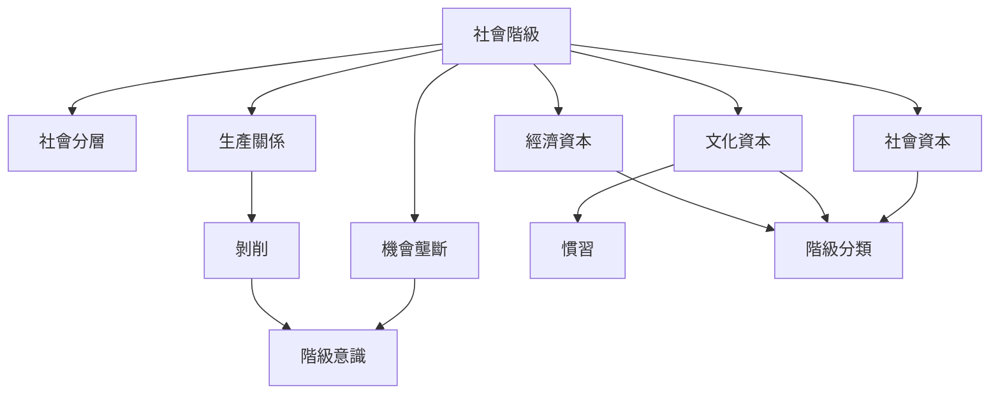

社會階級可從資源分布、經濟關係、制度封閉與文化實踐等不同角度理解。這張圖將基本理論與關鍵資本連起來，作為進入主題的第一張地圖。

核心閱讀可接續 [[階級是由資源與權力關係構成的社會位置]]、[[階級分析應同時考察剝削機會壟斷與生活條件]] 與 [[資本可以在家庭與制度之間相互轉換]]。

相關概念：[[社會階級]]、[[生產關係]]、[[剝削]]、[[機會壟斷]]、[[經濟資本]]、[[文化資本]]、[[社會資本]]、[[慣習]]、[[階級分類]]。

[[Social_class]]
