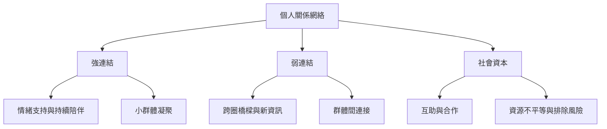

一個人的關係網絡不是單一親密圈，而是由不同強度、不同功能的連結組成。強連結較可能提供長期支持，弱連結較可能連接不同生活圈並帶來新資訊。社會資本則是關係網絡中可取得的資源，但它也會受到階級、身份與網絡排他性影響。

此圖連結 [[note/強連結與弱連結提供不同而互補的社會資源]]、[[note/社會資本既能提供互助也可能鞏固既有排除]] 與 [[note/互惠網絡使社會連結轉化為共同應對風險的能力]]。原始理論與批判證據分別見 [[data/弱連結能成為不同社交圈之間的橋樑]]、[[data/社會資本可能隨階級資源分布而累積並複製不平等]]。

概念入口：[[term/Social_network|社會網絡]]、[[term/Strong_ties|強連結]]、[[term/Weak_ties|弱連結]]、[[term/Social_capital|社會資本]]、[[term/Reciprocity|互惠]]、[[term/Social_support|社會支持]]。
