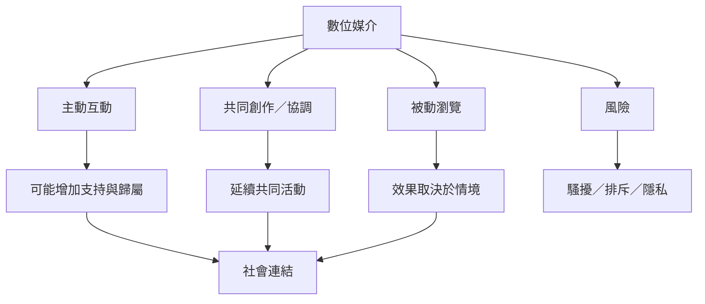

數位社群可跨越距離、延續共同活動與支持邊緣群體；但媒介的存在不保證關係品質，也可能帶來騷擾、排斥與注意力負擔。理解數位連結應追問互動形式、互惠程度、平台治理及與其他生活關係的連動。

核心閱讀為 [[note/數位媒介能擴展互動但不能自動提供關係品質]]，並參考 [[data/社群媒體與孤獨感的關係取決於互動情境而非單純使用時數]]。可搭配 [[idea/讓數位群組延續共同活動而不是以訊息量衡量活躍度]]，把線上平台轉化為互助與共同實踐的媒介。

概念入口：[[term/Digital_community|數位社群]]、[[term/Social_connection|社會連結]]、[[term/Social_support|社會支持]]。
