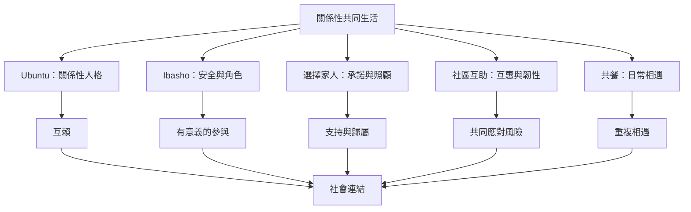

社會連結在不同文化與生活條件中，可能透過共餐、互助、共同創造、親屬關係與公共參與形成。Ubuntu、Ibasho、選擇家人及拉丁美洲社區互助各有其歷史與語境，不能被壓縮成一種集體文化，但都能幫助我們思考歸屬、互賴、角色與照顧如何實際發生。

參考 [[note/跨文化比較應學習關係實踐而不是建立文化刻板印象]]、[[note/關係性自我不必以犧牲個體自主為代價]] 與 [[note/有意義的社群角色能把被照顧者轉化為共同創造者]]。案例材料見 [[data/Ubuntu以關係性人格觀理解人與社群的相互構成]]、[[data/日本尼泊爾菲律賓與新加坡的Ibasho計畫以長者共創空間促進連結]]、[[data/哥倫比亞麥德林社區以互助照顧與互惠建立韌性]]。

概念入口：[[term/Ubuntu|Ubuntu]]、[[term/Ibasho|居場所]]、[[term/Chosen_family|選擇家人]]、[[term/Shared_meals|共享餐食]]、[[term/Interdependence|互賴]]、[[term/Collective_care|集體照顧]]。
