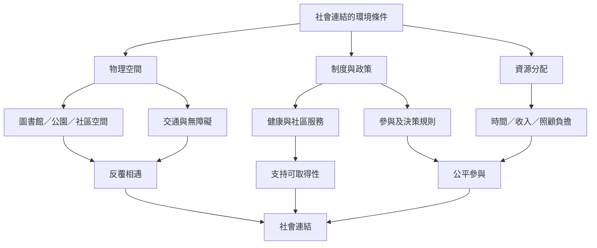

人們能否建立與維持連結，受到空間、時間、費用、交通、可近用性、公共政策與資源分配影響。社會基礎設施提供反覆相遇的機會；居場所與第三場所讓人能自在停留；有效介入則需回應不同人的實際障礙。

可先讀 [[note/社會基礎設施決定人們能否自然地反覆相遇]]，再讀 [[note/有效的連結介入必須回應參與者的具體障礙]]。研究案例包括 [[data/城市中的圖書館公園與日常場所構成社會基礎設施]] 與 [[data/日本居場所研究顯示安全感角色與意義感能支持高齡者福祉]]。

概念入口：[[term/Social_infrastructure|社會基礎設施]]、[[term/Third_place|第三場所]]、[[term/Ibasho|居場所]]、[[term/Social_prescribing|社會處方]]、[[term/Social_health|社會健康]]。
