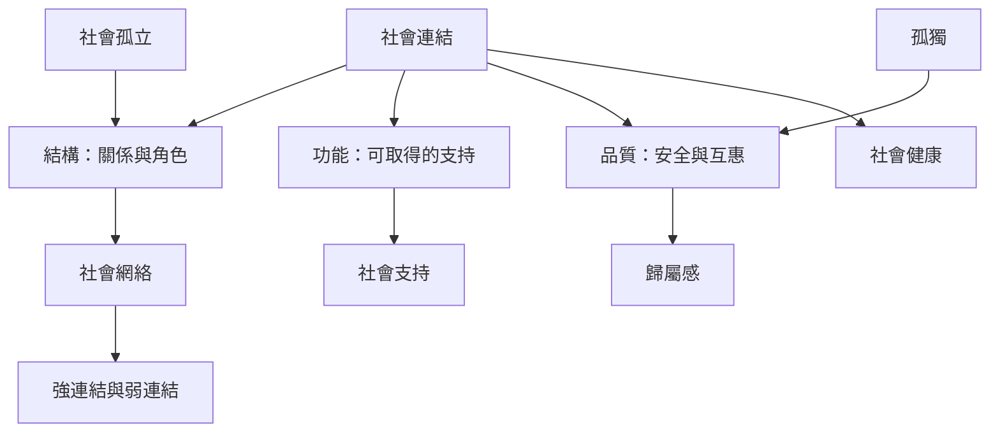

社會連結是人與人之間關係的整體樣貌，可從結構、功能與品質三個面向分析。結構說明網絡與互動模式，功能說明支持能否取得，品質則關乎安全、尊重與互相滿足。孤獨與社會孤立是重要但不同的斷連經驗；社會健康則把有意義的關係視為福祉本身的一部分。

閱讀時可先從 [[note/社會連結需要同時理解關係結構支持功能與互動品質]] 開始，再比較 [[note/孤獨感不能單靠外在接觸次數判斷]] 與 [[note/社會連結是公共健康與生活條件共同塑造的社會健康]]。三維架構的原始定義見 [[data/世界衛生組織將社會連結區分為結構功能與品質三個面向]]。

概念入口：[[term/Social_connection|社會連結]]、[[term/Social_health|社會健康]]、[[term/Social_support|社會支持]]、[[term/Social_network|社會網絡]]、[[term/Loneliness|孤獨]]、[[term/Social_isolation|社會孤立]]、[[term/Belonging|歸屬感]]。
