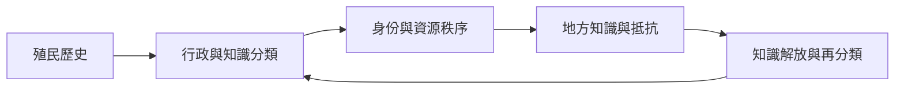

以印度、印尼、南非、巴西、中國及拉丁美洲、非洲知識論為例，提醒社會建構研究必須跨越全球北方的單一理論視角。

## 關係圖

## 永久筆記
- [[note/殖民行政分類能重組既有身份而非憑空創造身份]]
- [[note/全球知識秩序會延續殖民時期的權力分類]]
- [[note/國家分類能把可變身份固定成有後果的行政類別]]
- [[note/集體身份由國家敘事與日常關係共同協商]]
- [[note/情緒在互動關係與文化脈絡中共同生成]]

## 概念
- [[term/殖民性權力]]
- [[term/認識論不正義]]
- [[term/分類]]
- [[term/情境知識]]
- [[term/交織性]]
- [[term/集體身份]]
- [[term/立場理論]]
