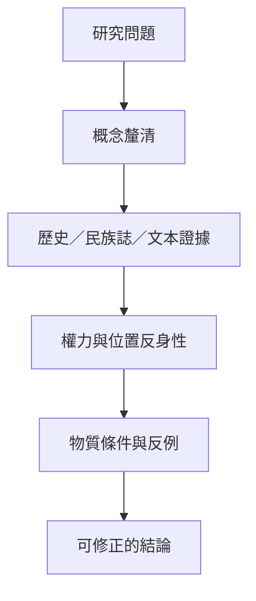

把概念釐清、歷史追蹤、論述分析、民族誌、語料分析與反身性結合，並持續檢查建構論的盲點：相對主義、忽略物質性及權力差異。

## 關係圖

## 永久筆記
- [[note/社會建構論必須指出建構對象與生成機制]]
- [[note/反身性與多元立場能改善知識的客觀性]]
- [[note/科學事實在實作共同體中被生產與穩定]]
- [[note/公共問題會在主張與回應的過程中被界定]]
- [[note/社會建構論需要同時分析權力與物質限制]]

## 概念
- [[term/系譜學]]
- [[term/立場理論]]
- [[term/情境知識]]
- [[term/批判實在論]]
- [[term/認識論不正義]]
- [[term/主張建構]]
- [[term/論述]]
- [[term/框架]]
- [[term/物質性]]
