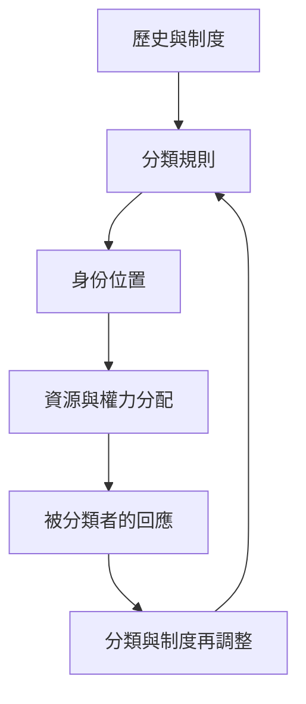

聚焦社會分類如何形成身份、邊界與資源分配，並追蹤殖民治理、國家行政、性別秩序與人類分類的回饋效應。

## 關係圖

## 永久筆記
- [[note/人類分類會回過頭改變被分類者]]
- [[note/殖民行政分類能重組既有身份而非憑空創造身份]]
- [[note/國家分類能把可變身份固定成有後果的行政類別]]
- [[note/集體身份由國家敘事與日常關係共同協商]]
- [[note/社會建構的現實可以真實地分配權力與資源]]

## 概念
- [[term/分類]]
- [[term/社會種類]]
- [[term/人類種類]]
- [[term/回饋效應]]
- [[term/交織性]]
- [[term/集體身份]]
- [[term/殖民性權力]]
- [[term/立場理論]]
- [[term/認識論不正義]]
- [[term/權力知識]]
- [[term/系譜學]]
