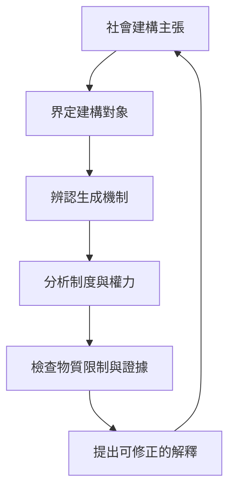

整理社會建構論的核心問題：什麼被建構、如何生成、知識如何成為常識，以及如何避免把建構誤解為虛無或任意相對主義。

## 關係圖

## 永久筆記
- [[note/社會建構論必須指出建構對象與生成機制]]
- [[note/制度透過外化客體化與內化而成為日常現實]]
- [[note/社會建構的現實可以真實地分配權力與資源]]
- [[note/揭示歷史偶然性可以開啟制度改變的可能]]
- [[note/社會建構論需要同時分析權力與物質限制]]

## 概念
- [[term/社會建構]]
- [[term/社會建構論]]
- [[term/社會建構主義]]
- [[term/知識社會學]]
- [[term/外化]]
- [[term/客體化]]
- [[term/內化]]
- [[term/制度化]]
- [[term/物化]]
- [[term/社會本體論]]
- [[term/批判實在論]]
- [[term/歷史偶然性]]
