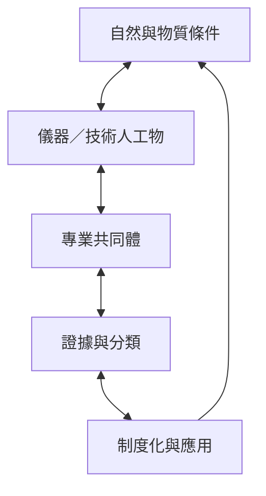

討論科學事實與技術人工物如何在實驗、設備、文件、專業共同體及相關群體協商中形成，同時保留物質世界的因果限制。

## 關係圖

## 永久筆記
- [[note/科學事實在實作共同體中被生產與穩定]]
- [[note/技術設計是相關群體協商與權力關係的結果]]
- [[note/社會建構論需要同時分析權力與物質限制]]
- [[note/障礙由身體狀況與社會環境障礙互動形成]]

## 概念
- [[term/科學知識社會學]]
- [[term/技術的社會建構]]
- [[term/詮釋彈性]]
- [[term/物質性]]
- [[term/批判實在論]]
- [[term/社會本體論]]
- [[term/社會建構]]
