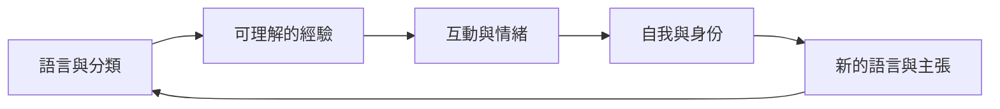

分析語言、論述、框架與文化情境如何形塑人們能夠理解、表達及經驗的事物，也關注自我與情緒如何在互動關係中形成。

## 關係圖

## 永久筆記
- [[note/語言不只描述現實也提供理解現實的框架]]
- [[note/情緒在互動關係與文化脈絡中共同生成]]
- [[note/自我是在關係與互動中持續形成的]]
- [[note/公共問題會在主張與回應的過程中被界定]]

## 概念
- [[term/論述]]
- [[term/框架]]
- [[term/情緒的文化建構]]
- [[term/情境知識]]
- [[term/社會化]]
- [[term/集體身份]]
- [[term/主張建構]]
- [[term/立場理論]]
