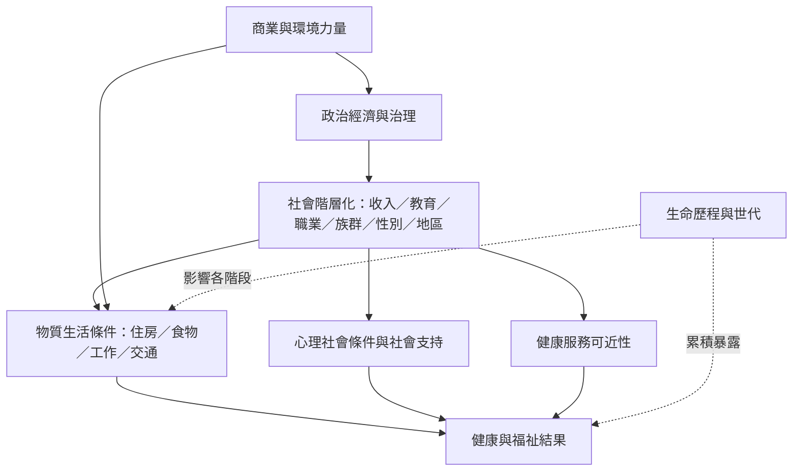

健康社會決定因素可以視為由政治經濟結構、社會階層化、生活條件到身體結果的多層次因果路徑。這張圖把上游制度與中介機制分開，提醒讀者不要把健康不平等簡化成個人行為差異。

可從 [[權力與資源分配決定結構性健康差異]]、[[結構性決定因素透過日常生活條件轉化為健康差異]] 開始，再讀 [[醫療可近性重要但不足以抵銷生活條件的不平等]]。相關概念包括 [[健康的社會決定因素]]、[[結構性決定因素]]、[[中介性決定因素]]、[[健康不平等]]、[[生態社會理論]]。

延伸：[[Social_determinants_of_health]]。
