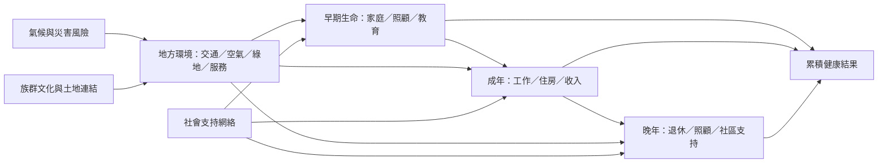

個體健康在生命歷程中與不同地點的生活條件互相作用。街區設施、工作環境、住房、交通、食物與社會關係會影響暴露和保護，而這些資源在地理空間中並非平均分布。

核心筆記：[[生命歷程中的風險與資源會逐步累積]]、[[健康風險由地方脈絡形塑而不能只看全國平均]]、[[環境風險會透過社區資源分配呈現不平等]]、[[社會支持網絡是健康資源但不能取代制度保障]]。

相關概念：[[生命歷程觀點]]、[[環境健康]]、[[原住民族社會情緒福祉]]、[[住房不穩定]]。

延伸：[[Social_determinants_of_health]]。
