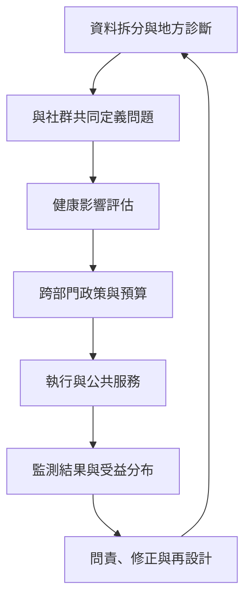

健康公平工作需要連結問題辨識、政策設計、跨部門執行、受益分布監測與問責。只有指標而沒有政策回應，資料不會自動帶來公平；只有政策宣示而沒有分組監測，也難以知道誰真正受益。

核心筆記：[[資料拆分能顯示平均數掩蓋的健康不平等]]、[[每項公共政策都應檢查健康公平影響]]、[[跨部門治理才能處理健康的上游成因]]、[[健康政策評估必須區分相關性與因果性]]。

相關概念：[[健康不平等監測]]、[[健康影響評估]]、[[所有政策納入健康]]、[[比例普遍主義]]、[[社會保護]]。

延伸：[[Social_determinants_of_health]]。
