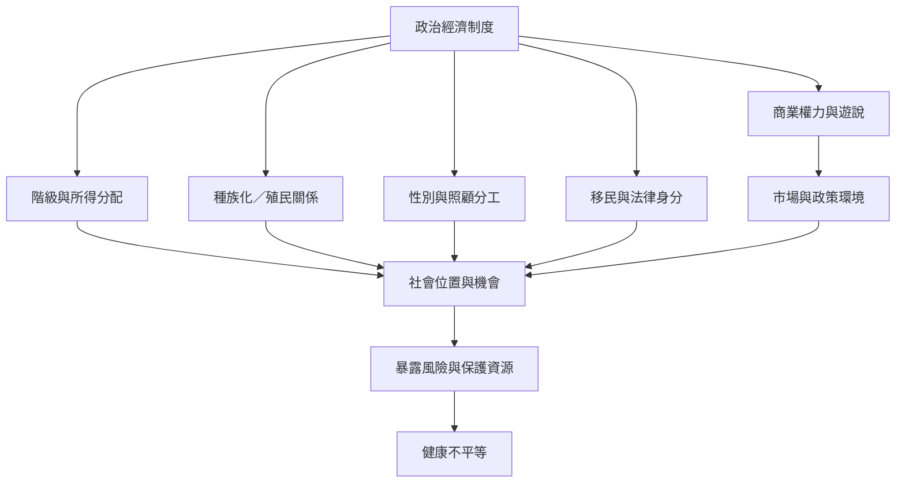

健康不平等不是單一資源不足，而是多種權力關係與社會位置交織後，讓風險與保護資源不均衡分配。這張圖把階級、族群、性別、障礙、移民身分與商業權力放入相同分析框架。

核心筆記：[[健康不平等是社會不平等在身體上的累積呈現]]、[[原住民族健康必須納入土地文化與自決]]、[[移民健康是法律身分與遷徙歷程共同形塑的結果]]、[[商業權力能透過市場環境與政治影響塑造健康]]。

相關概念：[[健康公平]]、[[交織性]]、[[結構性暴力]]、[[商業健康決定因素]]。

延伸：[[Social_determinants_of_health]]。
