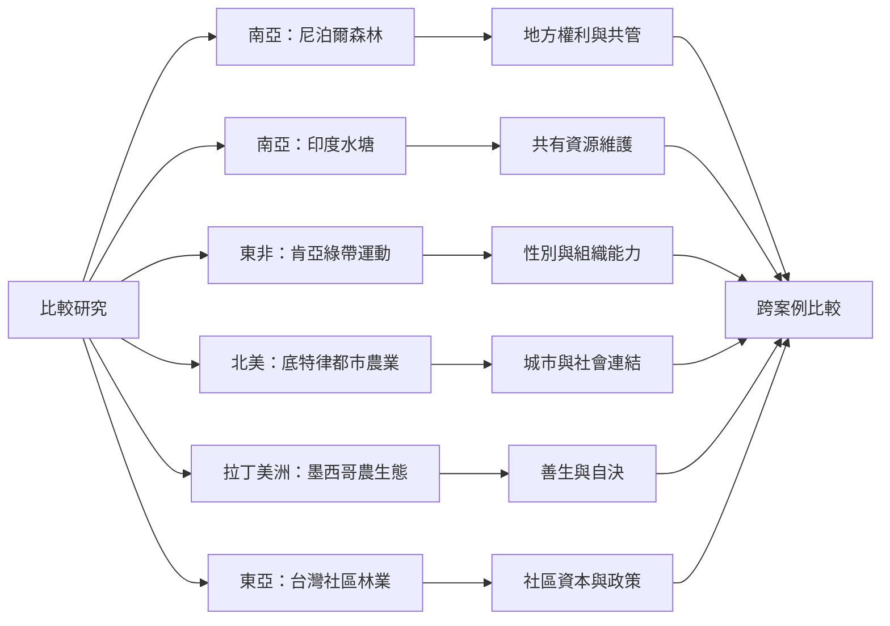

全球案例提供不同制度條件下的比較入口：尼泊爾社區林業呈現地方自治與保育官僚的張力；印度水塘治理呈現共同維護制度；肯亞綠帶運動連結女性組織與復育；美國都市農業呈現社會文化效益；墨西哥農生態實踐強調社群自決；台灣社區林業則連結政府政策、地方資本與共管。跨地區比較必須保留歷史、權利制度及知識脈絡。

## 關係圖

## 雙向連結
* 概念：[[社會生態系統]]、[[環境正義]]、[[多中心治理]]、[[農生態學]]、[[社區林業]]。
* 資料：[[尼泊爾保護區緩衝地帶林業顯示混合治理可能削弱地方自主]]、[[印度泰米爾納德邦研究發現社區參與有助於維持灌溉水塘]]、[[肯亞綠帶運動以女性植樹連結土地修復與社區生活]]、[[底特律都市農業研究發現社區凝聚也是重要生態服務]]、[[墨西哥原住民與農民社群以善生和共同性重塑農生態]]、[[台灣社區林業研究以共管與社區資本分析地方參與]]。
* 方法：[[跨領域知識共製能讓研究回應地方問題]]、[[研究資料庫應保留地方知識與資料限制]]。
