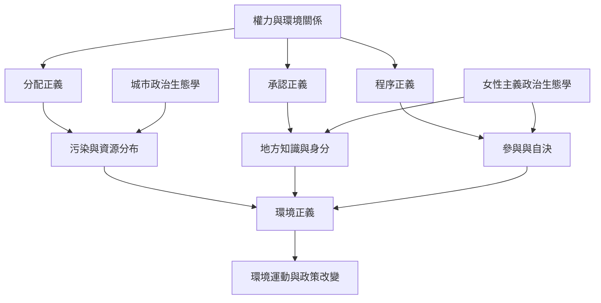

生態問題的分配結果往往沿著階級、種族、性別與殖民歷史形成。環境正義把利益與風險的分布、地方知識的承認，以及決策參與的品質放在同一框架；城市政治生態學與女性主義政治生態學則補充空間尺度和日常勞動的分析。

## 關係圖

## 雙向連結
* 概念：[[環境正義]]、[[環境種族主義]]、[[政治生態學]]、[[城市政治生態學]]、[[女性主義政治生態學]]、[[生態女性主義]]。
* 永久筆記：[[環境正義同時關乎分配承認與參與]]、[[城市環境是政治經濟關係所共同製造的結果]]、[[環境知識與勞動會沿著性別和階級不均分布]]。
* 資料：[[1991年環境正義原則把生態完整性與自決權連結]]、[[EJAtlas把全球環境衝突轉化為可比較的知識地圖]]、[[女性主義政治生態學分析性別化的資源權利與環境勞動]]。
