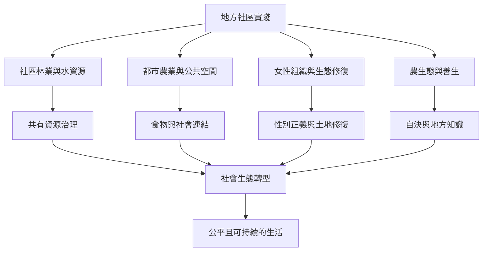

地方實踐是理論接受檢驗的場域。社區林業、水塘治理、都市農業、女性植樹運動與農生態行動，都顯示生態修復與生活改善需要同時處理資源權利、工作分配、地方知識和制度自主。這些案例不可直接複製，而應比較其條件與權力結構。

## 關係圖

## 雙向連結
* 概念：[[社區林業]]、[[農生態學]]、[[善生]]、[[公地]]、[[社會生態韌性]]。
* 永久筆記：[[生態修復必須同時評估生態與社會成果]]、[[都市農業的價值同時包含食物生產與社會連結]]、[[善生把生活品質放回社群與生態關係中理解]]。
* 案例：[[尼泊爾EnLiFT研究顯示參與式學習能連結林地生計與韌性]]、[[印度泰米爾納德邦研究發現社區參與有助於維持灌溉水塘]]、[[肯亞綠帶運動以女性植樹連結土地修復與社區生活]]、[[底特律都市農業研究發現社區凝聚也是重要生態服務]]、[[墨西哥原住民與農民社群以善生和共同性重塑農生態]]、[[台灣社區林業研究以共管與社區資本分析地方參與]]。
