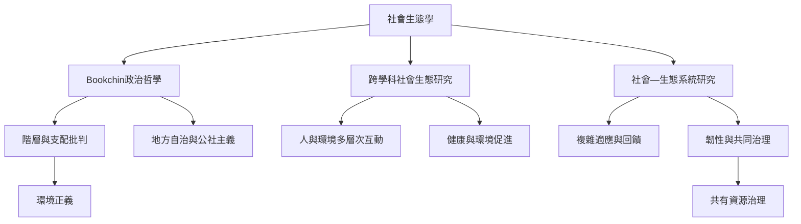

社會生態學可以從 Bookchin 的階層批判、UCI 的跨學科研究、公共衛生的多層次環境觀，以及社會—生態系統研究四條脈絡進入。這些脈絡共享人與環境不可分割的基本直覺，但在研究對象、方法與規範目標上必須區分。

## 關係圖

## 雙向連結
* 概念：[[社會生態學]]、[[人類生態學]]、[[生態系統理論]]、[[社會生態系統]]、[[政治生態學]]。
* 永久筆記：[[社會生態學具有政治哲學與跨學科研究兩種不同用法]]、[[生態危機不能脫離社會權力關係理解]]、[[人與環境應被理解為多層次的互動關係]]。
* 原始材料：[[Bookchin指出生態問題必須追溯深層社會問題]]、[[加州大學爾灣分校把社會生態學發展為跨學科研究領域]]。
