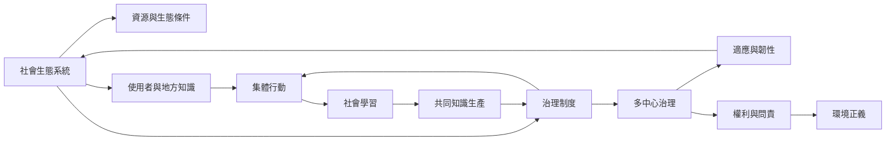

本圖從資源系統與使用者的互動出發，連接地方規則、社會學習、知識共製及跨尺度治理。核心問題不是哪一種治理模式普遍最好，而是什麼條件讓規則可被理解、執行、修正，且不把成本轉嫁給弱勢者。

## 關係圖

## 雙向連結
* 概念：[[社會生態系統]]、[[共有池資源]]、[[公地]]、[[集體行動]]、[[多中心治理]]、[[社會學習]]、[[共同知識生產]]、[[社會生態韌性]]。
* 永久筆記：[[共有資源不必在國家管制與私有化之間二選一]]、[[地方知識只有進入決策過程才能形成治理能力]]、[[參與只有能改變決策權才不會淪為象徵]]。
* 案例：[[Ostrom提出分析社會生態系統可持續性的通用框架]]、[[印度泰米爾納德邦研究發現社區參與有助於維持灌溉水塘]]、[[尼泊爾EnLiFT研究顯示參與式學習能連結林地生計與韌性]]。
