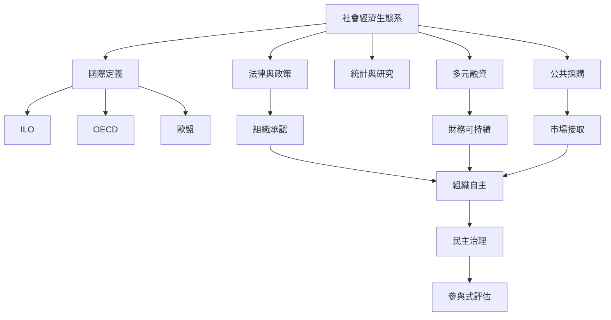

本圖聚焦政府如何建立社會經濟的制度條件，以及如何避免政策支持取代組織自治。國際定義、政策建議、法律、統計、融資與採購彼此相連，政策成效則需回到組織和成員的實際經驗檢查。

先閱讀[[ILO將社會與團結經濟界定為以互助民主與人本目的組織經濟活動]]、[[OECD把社會經濟政策視為組織生態系而非單一補助方案]]與[[聯合國將社會與團結經濟納入永續發展政策工具]]。再對照[[台灣社會企業政策研究指出政策工具與組織需求之間存在落差]]與[[政策產出不等於組織實際影響]]。

核心概念：[[社會經濟生態系]]、[[社會金融]]、[[社會採購]]、[[社會創新]]、[[民主治理]]、[[社會影響評估]]。
