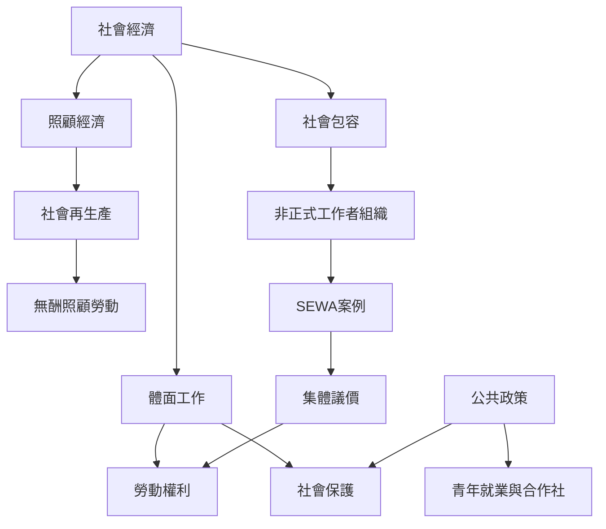

這張圖提醒讀者，社會經濟不只是企業治理，也涉及勞動權利、非正式工作、照顧與社會保護。衡量社會價值時，必須看見支持經濟生活的有酬與無酬工作。

從[[印度SEWA把女性非正式勞動者的集體組織連結到經濟安全]]開始，連結[[社會經濟必須把照顧勞動與非正式工作納入經濟分析]]，再閱讀[[塞內加爾把合作社納入青年就業政策顯示社會經濟能連結體面工作]]。

核心概念：[[體面工作]]、[[社會再生產]]、[[照顧經濟]]、[[互助組織]]、[[工人合作社]]、[[社會保護]]。
