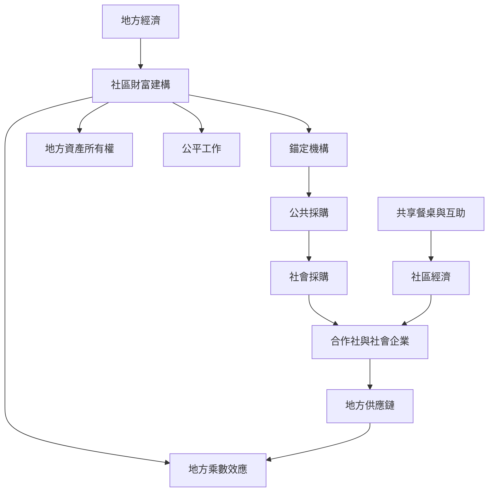

這張圖將社會經濟放在地方發展與資源流動的尺度上，關注採購、資產、就業與金融收益是否在社區中循環。它把組織層級的合作，連接到地方制度和公共支出。

可從[[Preston透過大型機構採購把地方支出轉化為社區財富]]理解制度支點，再閱讀[[公共採購可以成為地方財富分配的制度工具]]與[[地方經濟韌性取決於價值鏈是否留在社區]]。實作方向見[[以地方資金流向圖找出最容易啟動的社區財富支點]]。

核心概念：[[社區財富建構]]、[[社會採購]]、[[地方乘數效應]]、[[社會企業]]、[[合作社]]、[[共享資源]]。
