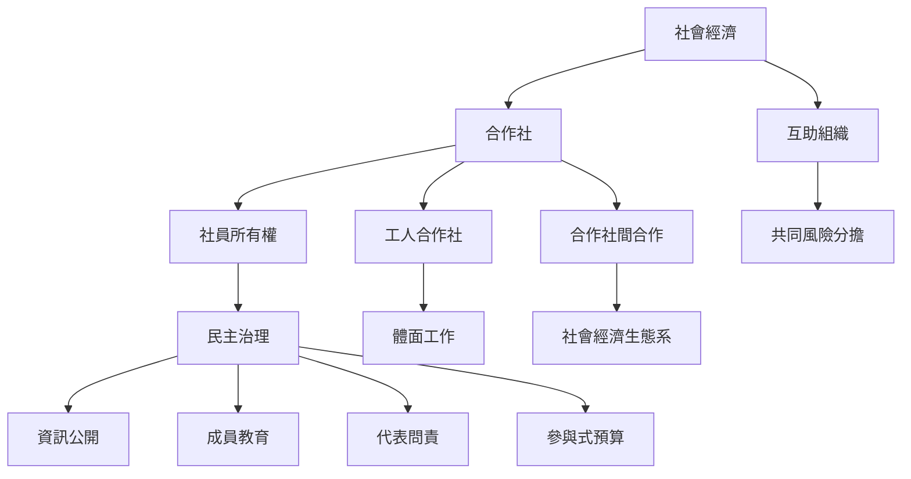

這張概念地圖整理社會經濟如何透過所有權安排與民主治理，把價值原則轉化為實際權力。核心不是法律形式本身，而是成員能否掌握資訊、參與決策、監督資產與分配盈餘。

閱讀本圖時，先從[[社會經濟]]進入，再看[[合作社]]和[[互助組織]]的不同設計。接著閱讀[[社員所有權只有在資訊與參與權可行使時才有意義]]與[[民主治理必須轉化為可被成員行使的權力]]，最後比較[[阿根廷工人收回企業顯示生產控制權可以由勞工重新組織]]及[[蒙德拉貢顯示合作社聯盟能支撐大規模工人所有企業]]。

核心概念：[[合作社]]、[[工人合作社]]、[[民主治理]]、[[互助組織]]、[[合作社間合作]]、[[體面工作]]、[[社員所有權]]。
