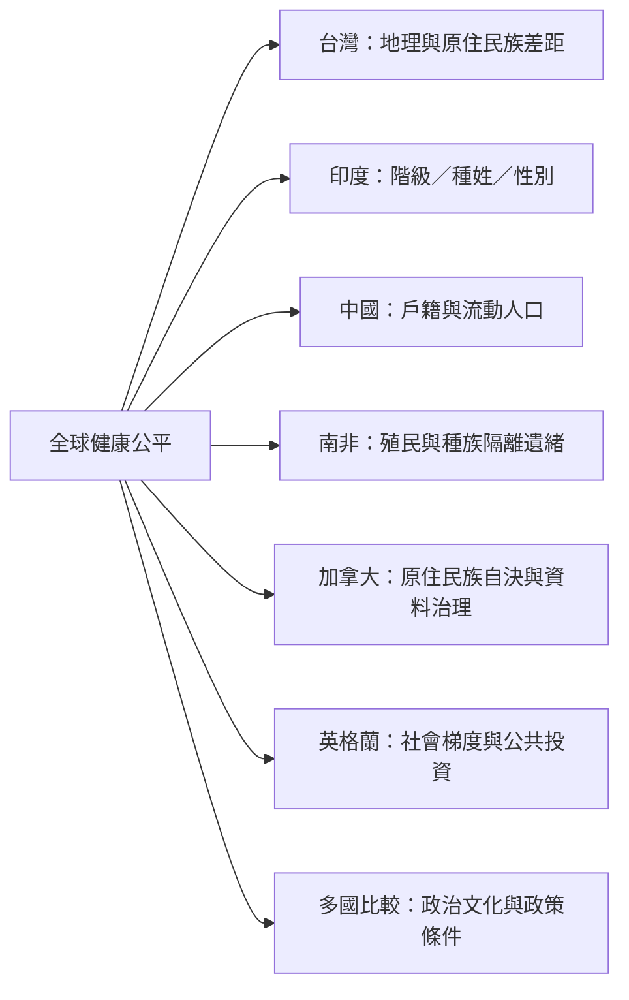

不同地區呈現不同的制度機制：台灣可觀察城鄉與原住民族地理差距；印度顯示階級、種姓與性別交織；中國內部流動人口凸顯戶籍資格；南非說明殖民與種族隔離遺緒；加拿大強調原住民族自決與資料主權；歐洲案例顯示社會保護及地方投資的重要性。跨國比較需保留歷史與制度差異。

概念連結：[[健康不公平]]、[[交織性]]、[[原住民族健康自決]]、[[地方效應]]、[[健康的政治經濟學]]。

全書導讀：[[Social_epidemiology]]。
