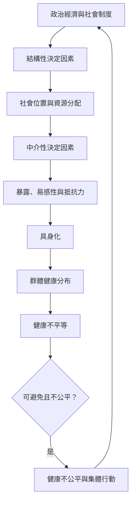

社會流行病學由健康分布出發，追問社會制度如何製造、分配與改變疾病風險。此圖把結構性決定因素、日常中介條件、具身化與健康公平串成一條可檢驗的路徑。

概念連結：[[社會流行病學]]、[[健康的社會決定因素]]、[[結構性決定因素]]、[[中介性決定因素]]、[[健康不平等]]、[[健康不公平]]、[[健康公平]]、[[健康梯度]]。

全書導讀：[[Social_epidemiology]]。
