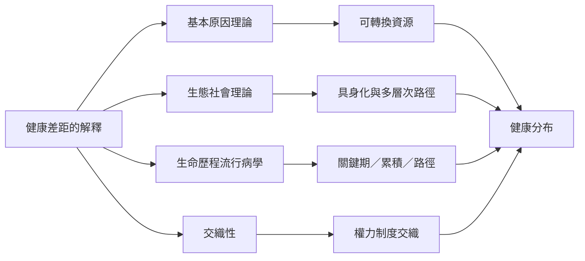

不同理論不是互斥標籤，而是對社會原因、因果路徑、時間尺度與權力責任提出不同問題。基本原因理論強調可轉換資源；生態社會理論強調具身化與歷史生態脈絡；生命歷程取徑強調時間累積；交織性分析強調權力制度共同運作。

概念連結：[[基本原因理論]]、[[生態社會理論]]、[[具身化]]、[[生命歷程流行病學]]、[[交織性]]、[[健康的政治經濟學]]。

全書導讀：[[Social_epidemiology]]。
