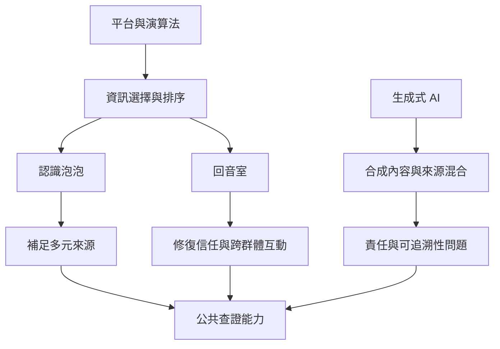

平台推薦、社群關係與生成式 AI 改變了資訊接觸、來源信任與錯誤更正的方式。[[認識泡泡]]主要涉及資訊缺席，[[回音室]]則涉及主動破壞外部信任；AI 生成內容進一步讓證言責任與來源追溯變得複雜。介入措施應同時處理資訊結構、信任關係與責任治理。

## 參考
* [[認識泡泡是資訊缺席而回音室是信任封閉]]、[[生成式人工智慧使證言責任與來源追溯變得更複雜]]、[[資訊素養需要修復信任關係而不只增加資訊量]]。
