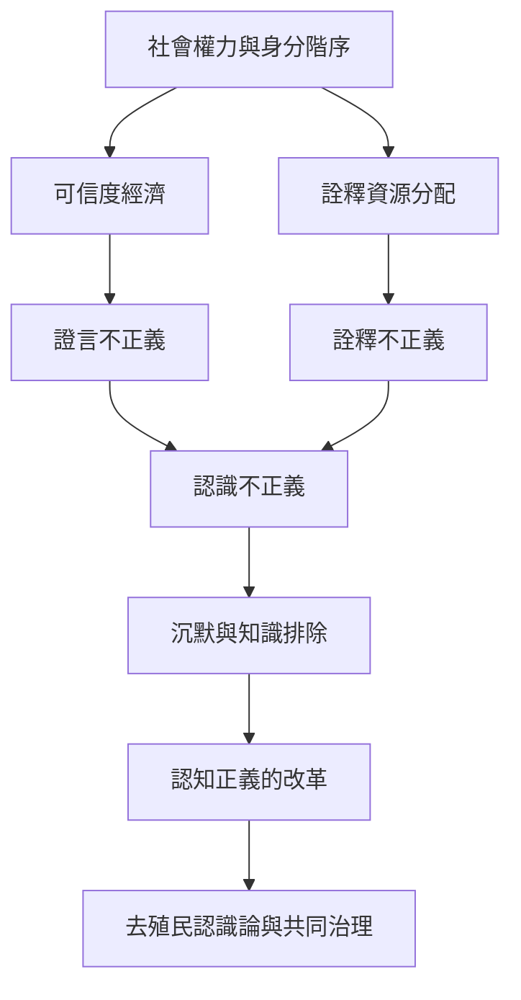

認識不正義不只發生在一對一的說話情境，也可能透過教育、媒體、研究機構與公共語言持續再生產。[[證言不正義]]影響誰被相信；[[詮釋不正義]]影響誰能為經驗命名；[[認知正義]]與[[去殖民認識論]]則把問題延伸到知識制度如何承認不同群體。

## 參考
* [[認識不正義揭示人會在作為知者的能力上受到傷害]]、[[抵抗認識不正義需要改變群體聆聽與回應的習慣]]、[[南方認識論把認知正義視為全球社會正義的條件]]、[[去殖民研究要求重新分配研究議程與資料控制權]]。
