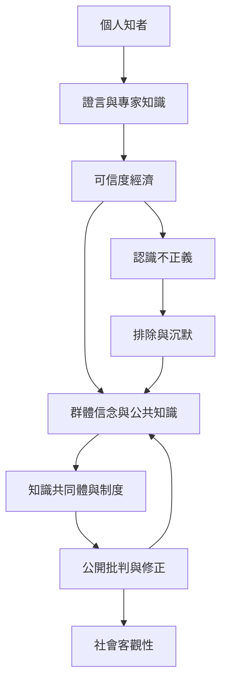

本圖整理社會認識論的基本架構：個人透過[[證言]]與[[專家知識]]接觸他人掌握的資訊；信任與可信度分配決定資訊是否被接納；知識共同體則透過批判、標準與制度保存或修正主張。整個過程可能產生[[認識不正義]]，也可能形成更可靠的[[社會客觀性]]。

## 參考
* [[社會認識論從個人信念轉向知識的社會條件]]、[[知識是透過證言與制度而分散在群體之中]]、[[可信度分配本身就是一種社會權力]]、[[知識共同體需要同時維護可靠性與可參與性]]。
