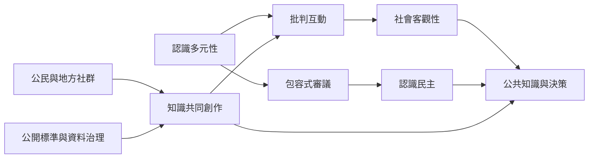

科學與民主都依賴多個知者的互動。[[社會客觀性]]關注批判如何提升知識品質；[[認識民主]]關注包容式參與如何改善公共判斷；[[知識共同創作]]則讓受影響者不只提供資料，也參與議程、詮釋與成果治理。

## 參考
* [[科學客觀性是批判互動所形成的集體成就]]、[[民主程序的認知價值取決於包容而非只有投票]]、[[知識共同創作必須共享議程與成果治理權]]、[[公民科學的知識共同創作同時受公民研究者與制度脈絡影響]]。
