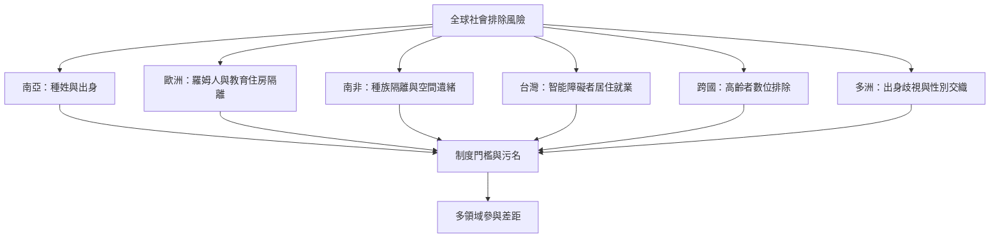

社會排除的機制具有可比較之處，但具體歷史與分類必須放回地方脈絡。南亞種姓、歐洲反羅姆歧視、南非種族隔離遺緒、台灣智能障礙者經驗，以及全球高齡者數位排除，呈現不同制度如何限制參與。跨國比較的目的不是把群體經驗同質化，而是找出權力、資源、認可與服務門檻的共同問題。

[[term/Intersectionality|交織性]]幫助理解群體內部差異；[[term/Discrimination|歧視]]與[[term/Structural_violence|結構性暴力]]連接不同地區的制度機制。跨國資料應避免混用資料年份、人口定義與抽樣範圍。

## 參考
* [[note/空間配置會把歷史排除沉積成今日的生活機會差異]]、[[note/就業改善不代表文化認可與平等參與已經實現]]。
* [[data/南亞種姓歧視透過污名與服務門檻延續社會排除]]、[[data/羅姆人調查顯示就業改善仍未消除歧視與隔離]]、[[data/南非的空間與種族不平等延續了制度性排除]]、[[data/台灣智能障礙者的排除同時涉及居住就業與家庭經濟]]、[[data/數位排除不只缺少網路也包含技能與使用意願]]、[[data/世襲職業與出身歧視跨越多個大洲並形成交織排除]]。
