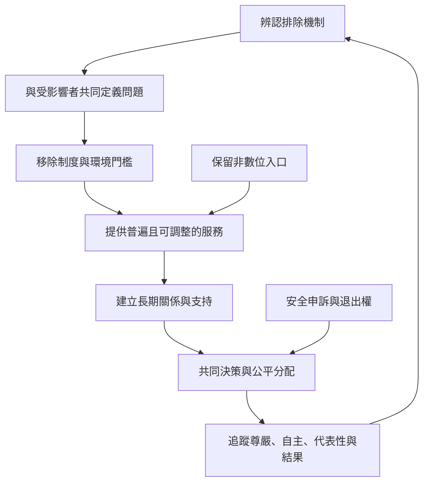

促進包容不只是把人帶進既有制度，而是讓制度本身變得可近、可理解、可協商並能接受問責。政策層面需要普遍服務與反歧視執法；組織層面需要多管道、合理調整、申訴與共同決策；社區層面則可透過長期關係、共享資源與低門檻活動，建立不以消費或資格為前提的參與空間。

[[term/Social_inclusion|社會包容]]不能只以參與人數衡量；[[term/Universalism_in_policy|政策普遍主義]]提供共同權利基礎，但仍需[[term/Disability_rights|身心障礙者權利]]所強調的合理調整。[[term/Belonging|歸屬感]]與[[term/Social_capital|社會資本]]有助理解關係支持，同時應防止圈內互惠演變成圈外排除。

## 參考
* [[note/形式平等不保證人們能平等使用公共服務]]、[[note/數位化公共服務必須保留非數位入口]]、[[note/持續的關係支持能讓脆弱的參與路徑變得可維持]]、[[note/真正的包容必須讓參與者保有議價權與退出權]]。
* [[idea/每項數位公共服務都應提供可用的非數位替代入口]]、[[idea/社區活動可以用低門檻共同生活取代資格審查式融入]]、[[idea/每個公共服務都可以進行一次排除門檻走查]]。
