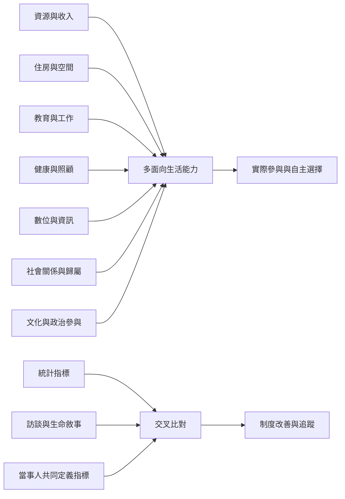

測量社會排除時，應將多個生活領域與不同證據類型放在一起。收入是重要資料，但還需觀察住房、教育、工作、健康、交通、數位、社會關係、文化承認、政治參與與申訴能力。不同領域並非可任意加總的同質指標；更重要的是理解它們如何交互影響。

[[term/Poverty|貧窮]]與[[term/Relative_deprivation|相對剝奪]]提供資源與比較視角；[[term/Capability_approach|能力取徑]]追問人們能否將資源轉化為真實選擇；[[term/Social_participation|社會參與]]則檢查是否能進入並影響公共生活。測量應同時結合數量與生活敘事，並記錄資料年份、定義與遺漏。

## 參考
* [[note/貧窮與社會排除相關卻不能互相替代]]、[[note/多領域劣勢的累積比單一匱乏更能揭示深度排除]]、[[note/測量社會排除必須結合統計指標與當事人的生活敘事]]。
* [[data/英國多面向社會排除矩陣避免把排除縮減成單一貧窮指標]]、[[data/全球社會排除估算顯示約三分之一人口面臨多重排除風險]]。
