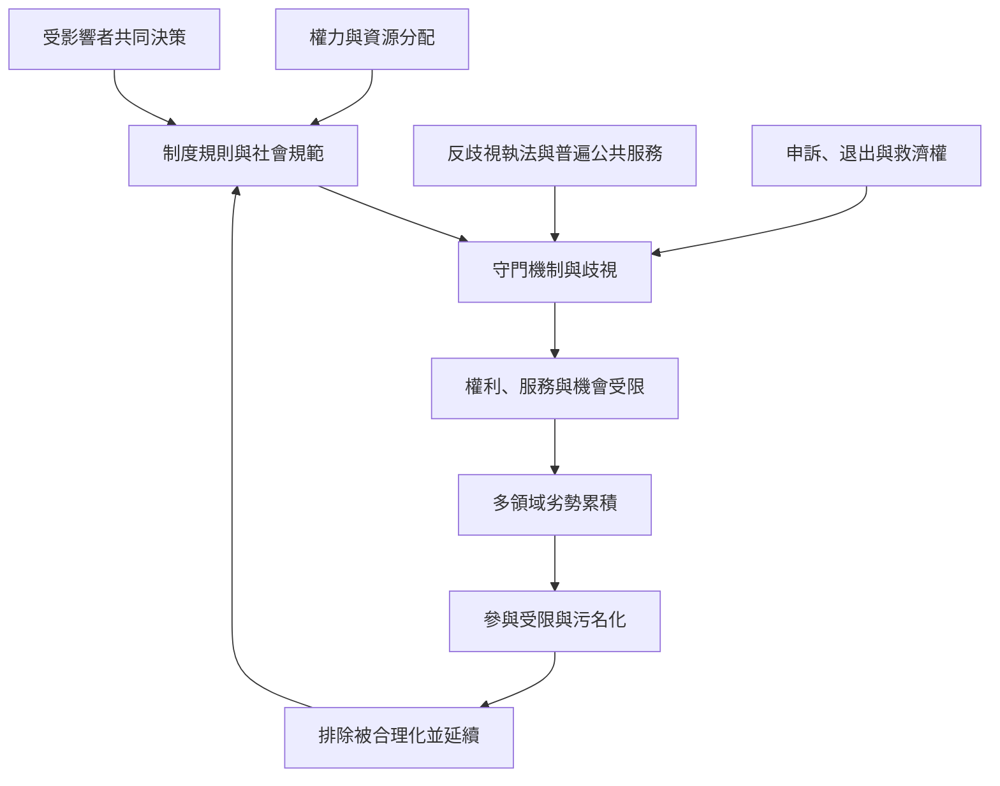

社會排除可以從「誰擁有制定規則與控制資源的權力」開始理解。它不只表現為某人被拒絕，也會透過污名、守門、法律制度、服務流程與市場關係累積成長期劣勢。分析時應從個人遭遇追溯到結構與權力，再回到可改變的制度節點。

[[term/Social_exclusion|社會排除]]是整體過程；[[term/Discrimination|歧視]]與[[term/Stigma|污名]]是常見機制；[[term/Gatekeeping|守門機制]]呈現誰控制入口；[[term/Structural_violence|結構性暴力]]則指出制度性傷害如何累積。[[term/Adverse_incorporation|不利納入]]提醒我們，即使進入市場或制度，仍可能以不平等方式參與。

## 參考
* [[note/社會排除是持續形成的關係過程而非個人身分]]、[[note/社會排除必須同時追問誰設門檻與誰承擔代價]]、[[note/真正的包容必須讓參與者保有議價權與退出權]]。
* [[data/社會排除的三種理論典範揭示團結差異與壟斷的衝突]]、[[data/社會排除研究需要把個人遭遇連回權利資源與能力的結構條件]]、[[data/不利納入說明被納入市場也可能持續遭受剝削]]。
