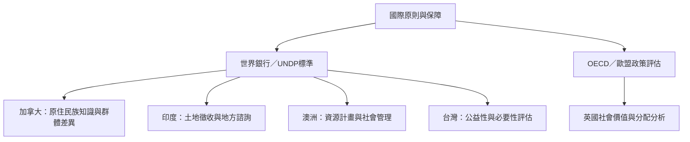

不同制度將 SIA 放在不同政策場域：國際金融機構將其納入環境與社會保障；歐盟強調政策制定中的比例原則與證據；加拿大重視原住民族知識、群體分列與累積效應；印度將土地徵收的社會影響研究與地方協商連結；澳洲昆士蘭將資源專案 SIA 納入法定程序；台灣土地徵收公益性評估已列出社會、經濟、文化、生態及永續因素。制度比較應同時看法律要求與實際決策權。

## 思與行
* 比較制度時，將「法定程序、參與權利、資訊揭露、獨立性、補救管道、執行監測」分開檢視。

## 參考
* 主要資料：[[世界銀行環境與社會框架將參與申訴及風險管理納入專案週期]]、[[加拿大影響評估要求納入原住民族知識與群體分列資料]]、[[印度土地徵收法把社會影響研究與地方諮詢制度化]]、[[澳洲昆士蘭大型資源計畫需提交社會影響評估並監測管理]]、[[台灣土地徵收公益性必要性評估涵蓋社會經濟文化生態與永續]]。
* 互補地圖：[[社會影響評估的參與權力與人權保障]]。
