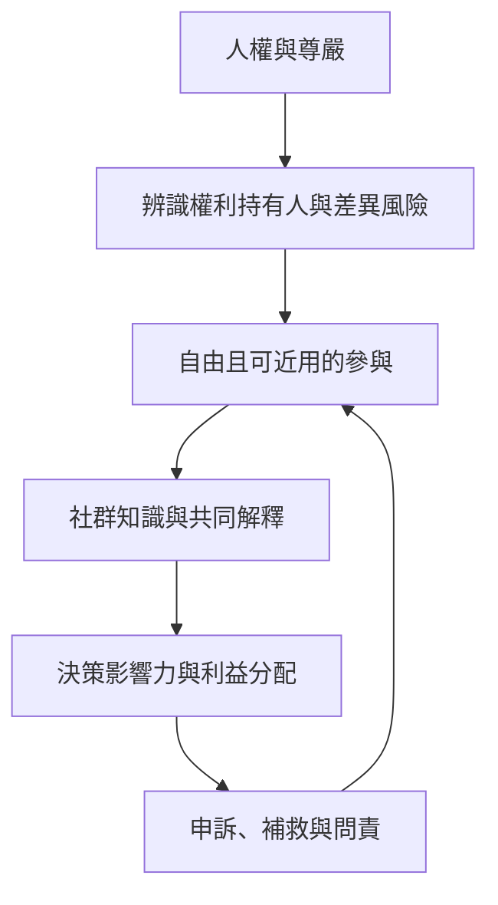

SIA 的可信度不只來自技術能力，也來自受影響者能否安全參與、以自己的知識解釋變化，並對影響其權利的決策產生實質作用。人權、原住民族自決、程序正義、分配正義與申訴補救共同構成評估的規範基礎。

## 思與行
* 以「誰有權定義問題、誰能影響決定、誰承受後果」檢查每個參與程序。

## 參考
* 核心筆記：[[程序正義要求參與者能影響決策而不只是表達意見]]、[[地方與原住民族知識是評估證據而非裝飾]]、[[正面成果不能自動抵銷基本權利受到的侵害]]、[[申訴機制是影響管理的回饋與補救管道而非公關窗口]]。
* 資料來源：[[聯合國原住民族權利宣言把自決與自由事先知情同意置於決策核心]]、[[企業人權盡職調查要求辨識預防減輕與說明不利影響]]。
* 互補地圖：[[社會影響評估的生命週期與管理架構]]。
