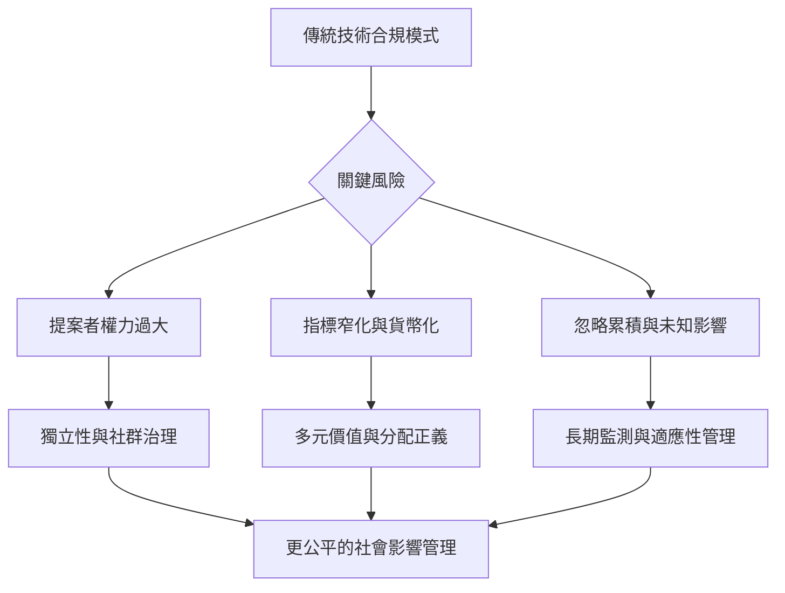

SIA 的主要風險包括提案者主導造成獨立性不足、以 ESG 或合規清單取代實質影響管理、用貨幣化與平均值掩蓋差異、低估累積與長期影響，以及把居民參與轉成無償資料勞動。未來實務需要更強的人權責任、原住民族自決、心理社會與創傷知情方法、社群共同監測、透明問責及適應性管理。

## 思與行
* 每份評估都加入「誰可能被排除」「未被量化的損失」「不確定與未知影響」三項反思。

## 參考
* 核心筆記：[[提案者付費可能使評估獨立性受到結構性壓力]]、[[社會價值不能被貨幣化指標完整代表]]、[[社會影響評估必須以適應性管理面對不確定與非預期後果]]。
* 最新研究：[[2026年社會影響評估的進展集中在人權原住民族權利與適應性管理]]。
* 互補地圖：[[社會影響評估的生命週期與管理架構]]、[[社會影響評估的參與權力與人權保障]]。
