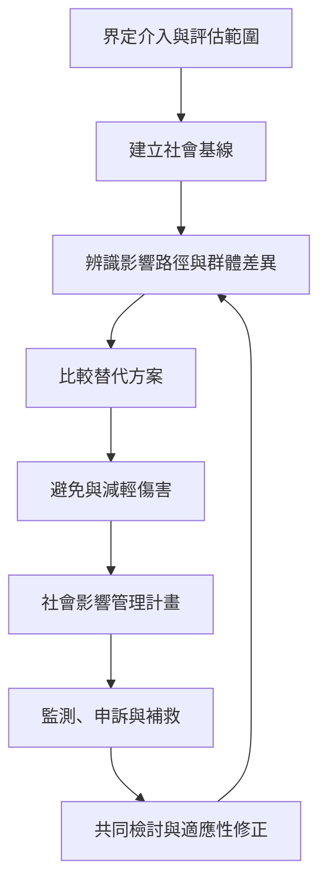

社會影響評估應沿著介入生命週期運作：由問題與範疇界定開始，理解基線與影響路徑，與受影響者比較替代方案，再建立避免、減輕、補救、監測及適應性管理機制。報告只是此循環中的一個節點。

## 思與行
* 用此圖檢查任何評估計畫是否缺少基線、替代方案、管理責任或後續回饋。

## 參考
* 核心筆記：[[社會影響評估是一種管理社會變遷的實踐而不只是預測工具]]、[[社會影響評估必須以適應性管理面對不確定與非預期後果]]、[[影響評估應在方案仍可改變時介入決策]]。
* 研究來源：[[社會影響評估必須貫穿介入生命週期而非只完成審查報告]]、[[良好社會影響評估以參與和影響管理而非單次預測為核心]]。
* 互補地圖：[[社會影響評估的參與權力與人權保障]]、[[社會影響評估的證據衡量與評估設計]]。
