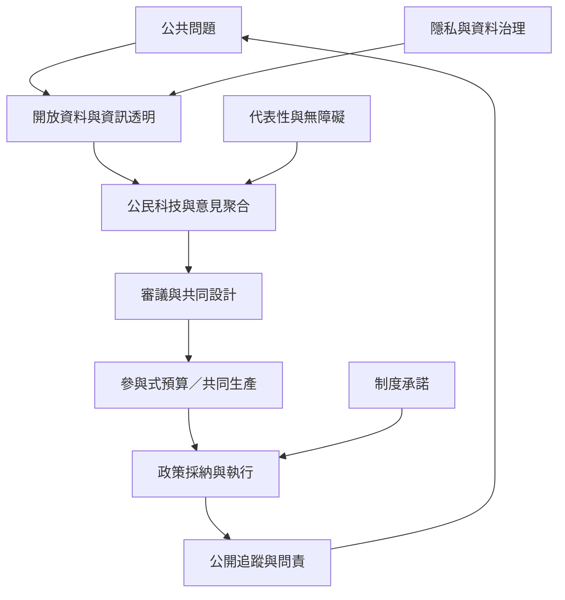

公民科技、共同生產與參與式預算都是民主創新的可能形式，但技術或諮詢本身不會自動帶來民主。重要的是參與能否影響議程、決策、預算與監督，且讓未被聽見的人也能進入流程。

概念連結：[[Civic_tech]]、[[Participatory_budgeting]]、[[Co_production]]、[[Co_design]]、[[Social_innovation]]、[[Institutional_entrepreneurship]]。

案例入口：[[台灣公民科技顯示開放協作能把公共問題轉化為制度共創]]、[[波多阿雷格里參與式預算顯示民主創新需要持續制度支持]]。
