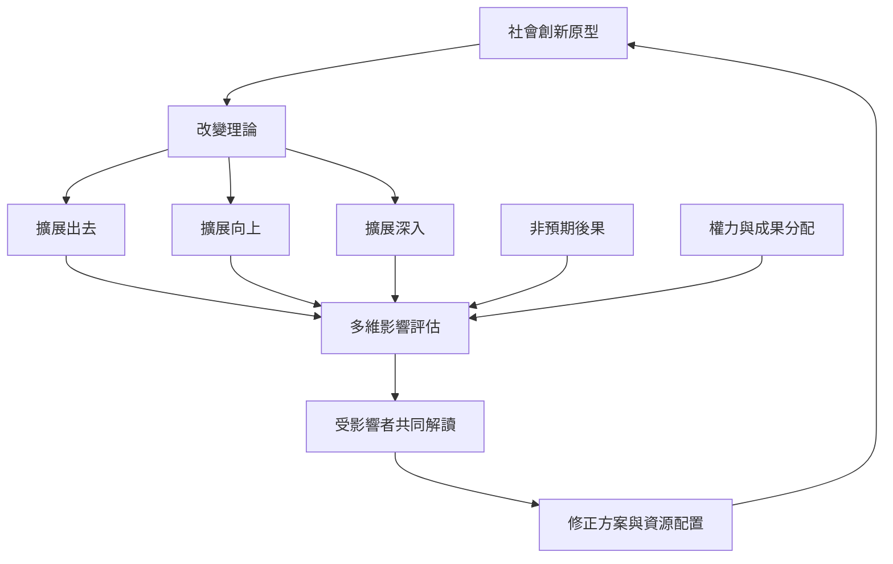

擴展不是單純擴大規模，而是同時觀察做法的地理擴散、制度改變與文化深化。評估則要呈現社會價值、能力分配、負面後果與不同群體的差異。

概念連結：[[Scaling_out]]、[[Scaling_up]]、[[Scaling_deep]]、[[Theory_of_change]]、[[Social_impact_measurement]]、[[Systems_change]]。

案例與方法：[[擴展社會創新必須同時處理擴散制度與文化三個尺度]]、[[社會創新成效需要多維指標而不是單一受益人數]]、[[資助方案應設計權力移交與退出機制]]。
