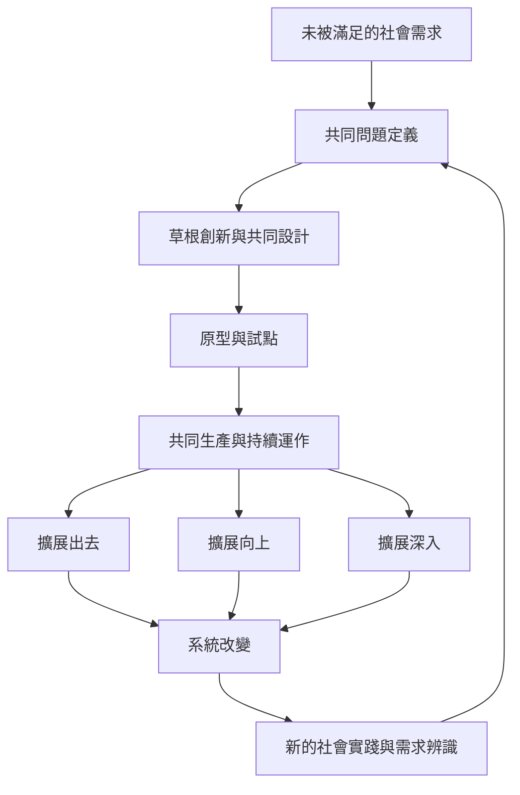

社會創新可從問題回應、社會實踐、集體行動與制度改變幾個層次理解。下圖把核心概念放進同一個過程：地方需求與草根能力促成方案，協作與原型形成新實踐，制度與文化改變決定它能否持續。

概念連結：[[Social_innovation]]、[[Social_change]]、[[Grassroots_innovation]]、[[Co_design]]、[[Co_production]]、[[Systems_change]]、[[Scaling_out]]、[[Scaling_up]]、[[Scaling_deep]]。

延伸閱讀：[[社會創新的核心不只是新方案而是社會關係的改變]]、[[好的社會創新必須從受影響者定義問題]]、[[社會創新原型必須測試假設而不只是展示創意]]。
