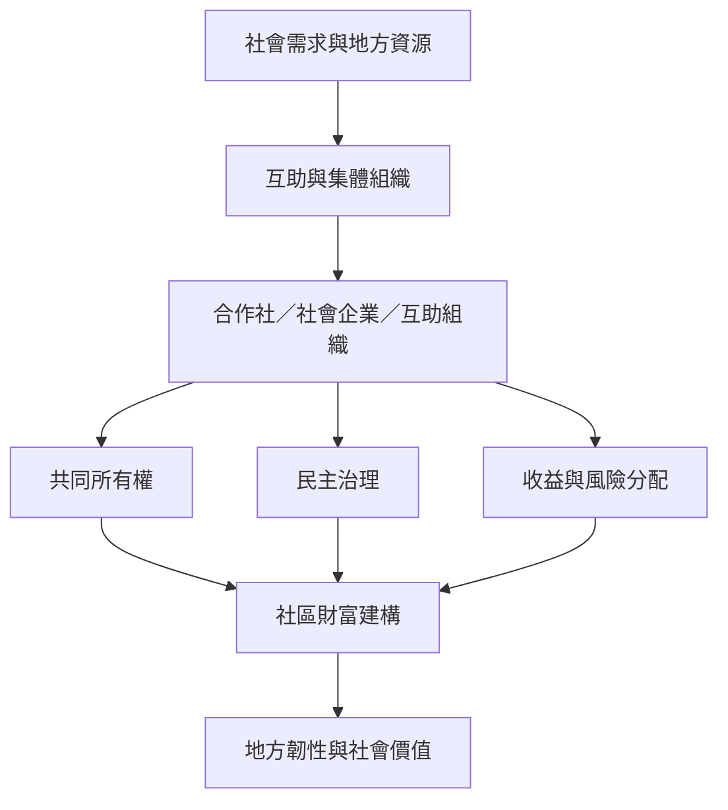

社會創新可以藉由合作社、互助組織、社會企業與社區資產治理，改變經濟活動的所有權、收益分配與決策方式。這些形式不必然公平，仍需檢查治理權、勞動條件與外部性。

概念連結：[[Social_and_solidarity_economy]]、[[Social_enterprise]]、[[Social_entrepreneurship]]、[[Community_wealth_building]]、[[Social_capital]]、[[Social_innovation]]。

案例入口：[[印度SEWA透過工人合作社讓非正式女性勞動者集體組織經濟]]、[[喀拉拉Kudumbashree以社區婦女網絡連結經濟支持與公共行動]]、[[拉丁美洲團結經濟的制度多樣性提醒創新必須在地化]]、[[歐洲能源合作社顯示能源轉型也是民主治理創新]]。
