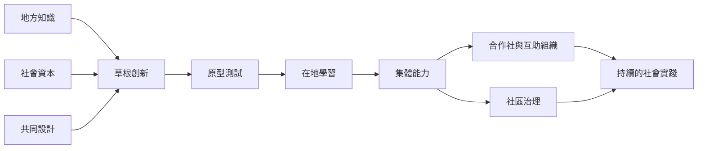

草根創新不是低成本版本的專業服務，而是社區將知識、關係、資源與行動能力重新組合的過程。它需要注意社群內部差異，也需要外部制度支持，避免把資源匱乏浪漫化。

概念連結：[[Grassroots_innovation]]、[[Social_capital]]、[[Co_design]]、[[Social_and_solidarity_economy]]、[[Community_wealth_building]]、[[Social_innovation]]。

案例入口：[[南非社區的節用型社會創新顯示資源匱乏也能促成集體創造]]、[[孟加拉BRAC以在地實驗與跨領域整合擴展發展實踐]]、[[印度SEWA透過工人合作社讓非正式女性勞動者集體組織經濟]]。
